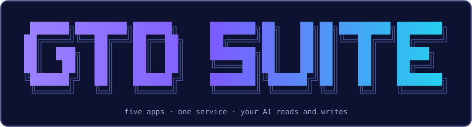

<p align="center"></p>

# GTD suite

Five apps you share with your AI. Give Claude, ChatGPT or any MCP client one link and it
can read and write your todos, notes, projects, pages and memory.

> [!TIP]
> **Use it free at [todogtd.com](https://todogtd.com).** Nothing to install: sign up, connect your AI, and you're going in a couple of minutes.

- **Todo GTD**: inbox, next actions, projects and the weekly review.
- **Notes GTD**: Markdown notes with tags, colours and pins.
- **Projects GTD**: boards, to-dos, messages, docs and a calendar.
- **Simple Sites**: publish a page or a short link in one step.
- **Common Brain**: one memory that every AI you use reads and writes.

## Connect your AI

Open **Settings → Connect your AI**, copy your agent link and paste it into your AI tool.
Most take it as an MCP server address; tools that browse can just open it. The link works
like a password, so keep it to yourself.

Scripts can use the same link over plain HTTP ([Agent Commands](docs/agent-commands.md)),
or a program key with the REST API ([docs/api.md](docs/api.md)).

## Run it yourself

**Docker:** set `PUBLIC_BASE_URL` in `docker-compose.yml`, then

```sh
docker compose up --build -d
```

Open the address and press **Start**. The first visitor owns it.

**Railway:** deploy your fork from GitHub, add a volume at `/data`, set `TRUST_PROXY=1`,
generate a domain and set the healthcheck path to `/healthz`. Then open it and press **Start**.

Run one worker and one replica; the app is a single process on purpose. Settings, backups,
restores and the admin tool are in [docs/self-hosting.md](docs/self-hosting.md).

## Develop

```sh
uv sync && (cd frontend && npm ci)
OPEN_SIGNUP=true uv run uvicorn backend.main:app --workers 1 --reload
cd frontend && npm run dev
```

Run `scripts/check.sh` before a pull request. See [CONTRIBUTING.md](CONTRIBUTING.md), and
report security issues as [SECURITY.md](SECURITY.md) describes.

## License

[MIT](LICENSE). The app names (Todo GTD, Notes GTD, Projects GTD, Simple Sites, Common
Brain) aren't licensed with the code, so a public fork should pick its own.

GTD® and Getting Things Done® are registered trademarks of the David Allen Company. This
project isn't affiliated with or endorsed by them.
